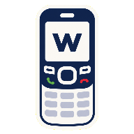
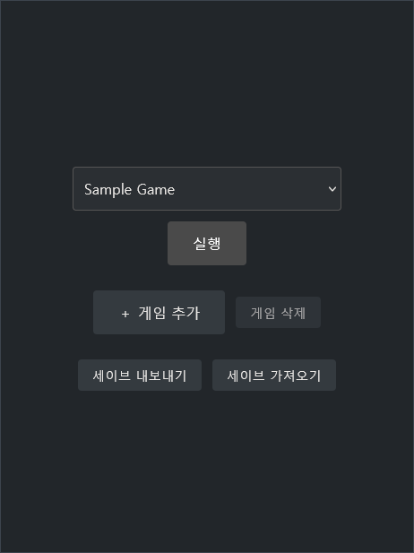
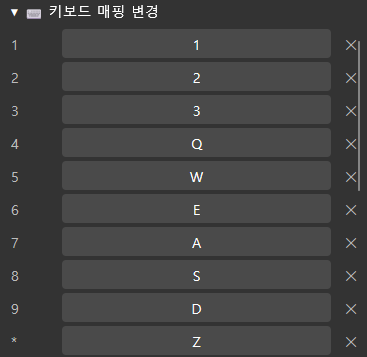
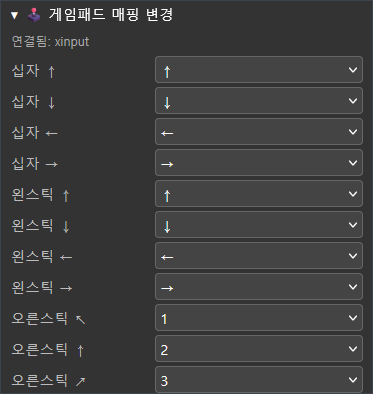
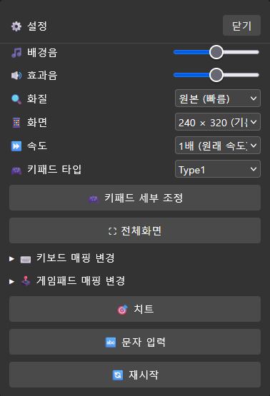
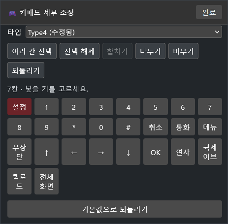
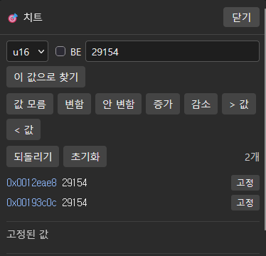

# W-Feature

**WIPI 에뮬레이터**

KTF · LGT · SKT 피쳐폰 게임 지원

**[다운로드](https://github.com/movingwoo/wfeature/releases) · [시작하기](#시작하기) · [사용법](#사용법) · [문서](docs/README.md) · [변경 내역](CHANGELOG.md)**

> [!WARNING]
> 개발 중인 에뮬레이터입니다. 모든 게임이 실행되지 않을 수 있습니다.  
> 문제가 생기면 디버그 로그와 함께 제보해 주세요.

## 특징

- KTF·LGT·SKT 게임 지원
- 퀵세이브·퀵로드 지원 및 세이브 가져오기, 내보내기 지원
- 키보드, 게임패드, 가상 키패드 지원
- 화질개선 필터, 0.25~4배속 기능 제공
- 자체 치트엔진 기능 제공

## 시작하기

[Releases](https://github.com/movingwoo/wfeature/releases)에서 운영체제에 맞는 파일을 받아 실행합니다.

| | 실행 | 처음 한 번 |
|---|---|---|
| Windows | `start.bat` 더블클릭 | SmartScreen → 추가 정보 → 실행, 방화벽 허용 |
| macOS | `start.command` 더블클릭 | Control-클릭 → 열기 (서명된 앱이 아님) |
| Linux | `./start.sh` | 권한 문제 시 `chmod +x start.sh wfeature-server` |
| Android | `.apk` 설치 | 출처를 알 수 없는 앱 허용 |
| iOS | `.ipa` 사이드로드 | AltStore·Sideloadly로 본인 Apple ID 서명 |

폴더에 직접 파일을 넣거나 **＋ 게임 추가** 버튼을 통해 파일을 넣을 수 있습니다.
운영체제별 안내는 각 압축파일 내 `README.txt`를 확인해주세요.

소스코드를 다운받아 구동하려면 Go 1.26 이상이 필요하며 자세한 내용은 [`docs/running.md`](docs/running.md)에 있습니다.

## 사용법

<b>키보드</b>

 

| 키보드 | 전화기 키 |
|---|---|
| 방향키 | 위 / 아래 / 왼쪽 / 오른쪽 |
| Space | 가운데(확인) |
| Backspace | 취소 (CLR) |
| \ | 통화 |
| M | 메뉴 (왼쪽 위 소프트키) |
| , | 우상단 (오른쪽 위 소프트키) |
| 1 2 3 | 1 2 3 |
| Q W E | 4 5 6 |
| A S D | 7 8 9 |
| Z X C | \* 0 # |

임의로 **설정 → ⌨️ 키보드 매핑 변경**에서 커스텀할 수 있습니다.

<b>게임패드</b>

 

패드를 연결하고 아무 버튼이나 한 번 누르면 사용할 수 있습니다.

| 게임패드 | 전화기 키 |
|---|---|
| 십자키 / 왼스틱 | 위 / 아래 / 왼쪽 / 오른쪽 |
| 오른스틱 | 숫자 1~9 — 5를 둘러싼 8방향 (↖ 1, ↑ 2, ↗ 3, ← 4, → 6, ↙ 7, ↓ 8, ↘ 9) |
| A / B | 가운데(확인) / 취소 (CLR) |
| X / Y | 5 / 0 |
| LB / RB | 메뉴 / 우상단 |
| LT / RT | \* / # |
| View / Menu | 통화 / 설정 열기·닫기 |
| L3 / R3 | 연사 전환 / 전체화면 |
 
**설정 → 🕹️ 게임패드 매핑 변경**에서 커스텀할 수 있습니다.

<b>설정</b>

 

키패드의 빨간 `설정` 키를 누릅니다.

- **🎵 배경음 / 🔊 효과음** — 음량
- **🔍 화질** — 원본 / hq2x / hq3x / hq4x
- **📱 화면** — 게임이 인식하는 단말 화면 크기(128×160 ~ 320×480)
- **🎮 키패드 타입 / 세부 조정** — 키패드 배치를 고르거나 직접 편집
- **⛶ 전체화면** — 키패드를 숨기고 게임 화면 확대
- **📳 진동** — 진동 여부
- **⏩ 속도** — 0.25배~4배
- **🎯 치트** — 게임 메모리 값 찾기·고정
- **🔄 재시작** — 게임 선택 화면으로 돌아가기

<b>가상 키패드 편집</b>

 

**설정 → 🎮 키패드 세부 조정**에서 14열×9행 격자에 키를 배치합니다.

1. 버튼이나 빈 칸을 누르고 넣을 키를 고릅니다.
2. **여러 칸 선택**으로 칸을 고르고 **합치기**를 누르면 병합 가능합니다.

<b>세이브와 퀵세이브</b>

 

게임 안에서 저장한 세이브는 `var/savedata/`에 기록됩니다.  
게임 선택 화면의 **세이브 내보내기 / 가져오기**로 세이브를 백업합니다.

**퀵세이브**는 지금 실행 상태(화면·진행·소리·입력)를 저장하고 **퀵로드**는 게임을 그 시점으로 되돌립니다.

<b>치트</b>

 

1. 바꾸려는 값을 치트 패널에 넣고 **이 값으로 찾기**를 누릅니다.
2. 게임에서 값을 바꾼 뒤 새 값으로 다시 찾습니다. 후보가 줄어들 때까지 반복합니다.
3. 찾은 주소를 **고정**하면 값이 유지됩니다. 값을 편집하면 변경됩니다.

## 라이선스

[MIT](LICENSE). 번들된 구성 요소는 각자의 라이선스를 따르며 전문은 [`THIRD-PARTY-NOTICES.md`](internal/licenses/THIRD-PARTY-NOTICES.md)에 있고 모든 릴리스 바이너리에 포함됩니다.

| 구성 요소 | 쓰임 | 라이선스 |
|---|---|---|
| `golang.org/x/text`, `golang.org/x/image` | Go 모듈, 정적 링크 | BSD-3-Clause |
| `golang.org/x/sys` | Go 모듈, macOS·Windows·linux/amd64 대상에 정적 링크 | BSD-3-Clause |
| NeoDGM (Neo둥근모) | 임베드 폰트 | SIL OFL 1.1 (Reserved Font Name) |
| Galmuri9 | 임베드 폰트 | SIL OFL 1.1 (Reserved Font Name) |
| hqx | `internal/filter/hqx`와 `web/hqx-patterns.js`의 결정 테이블 번역본 | MIT OR Apache-2.0 |

## 후원

프로젝트가 마음에 드셨다면 [GitHub Sponsors](https://github.com/sponsors/movingwoo)로 후원하실 수 있습니다.  
후원 여부와 관계없이 모든 기능은 동일하게 제공됩니다.
